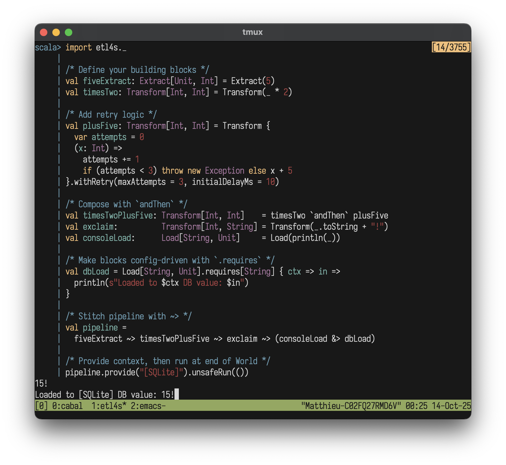
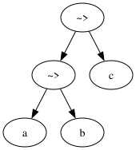
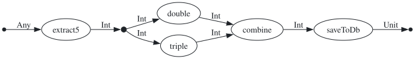
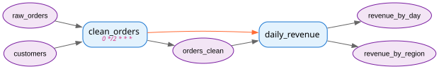

<div align="right">
  <sub><em>part of <a href="https://github.com/mattlianje/cabinet6">c6</a></em></sub>
</div>

<p align="center">
  
</p>

#  etl4s
**Powerful, whiteboard-style ETL**

A lightweight, zero-dependency library for writing type-safe, beautiful ✨🍰  data flows in functional Scala. 
Battle-tested at [Instacart](https://www.instacart.com/).

- [Full documentation](https://mattlianje.github.io/etl4s/)

## Features
- Declarative, typed pipeline endpoints
- Zero dependencies
- Type-safe, compile-time checked
- Config-driven by design
- Easy composition of pipelines as free-arrows
- Effect polymorphic: easily runs on CE, ZIO, Kyo
- Built-in retry/failure handling
- Pipeline visualization

## Installation

**etl4s** is on MavenCentral and cross-built for Scala 2.12, 2.13, 3.x
```scala
"xyz.matthieucourt" %% "etl4s" % "2.0.0"
```
Or try in REPL:
```bash
scala-cli repl --scala 3 --dep xyz.matthieucourt::etl4s:latest.release
```

## Quick Example
```scala
import etl4s._

val getUser  = Extract("John Doe")
val getOrder = Extract("Order #1234")
val combine  = Transform[(String, String), String] { case (user, order) =>
  s"$user placed $order"
}
val saveDb    = Load[String, String](s => { println(s"DB: $s"); s })
val sendEmail = Load[String, Unit](s => println(s"Email: $s"))

val pipeline = (getUser & getOrder) ~> combine ~> (saveDb & sendEmail)

pipeline.unsafeRun()
```
- `&` tuples the outputs of `getUser` and `getOrder`
- `combine` merges the tuple into one string, sent to both `saveDb` and `sendEmail`
- Nothing runs until `unsafeRun`

Need to clean the combined data? Just add a `clean` node:

```scala
val pipeline = 
     (getUser & getOrder) ~> combine ~> clean ~> (saveDb & sendEmail)
```

## Why etl4s?

- Ultimately, these nodes and pipelines are just reifications of functions and values with a few extra niceties.
- Chaotic, framework-coupled ETL codebases that grow without an imposed discipline drive dev teams and data orgs to their knees.
- **etl4s** is a lightweight DSL to enforce discipline, type-safety, and reuse of pure functions - and see [functional ETL](https://maximebeauchemin.medium.com/functional-data-engineering-a-modern-paradigm-for-batch-data-processing-2327ec32c42a) for what it is... and could be.

It works with anything (Spark, Flink, Beam, streaming, web-server dataflows, local scripts) and runs on the JVM, in the browser, or as a native binary.

## Catch broken pipelines at compile time
**etl4s** won't let you chain together blocks that don't fit:
```scala
 val fiveExtract: Extract[Unit, Int]        = Extract(5)
 val exclaim:     Transform[String, String] = Transform(_ + "!")

 fiveExtract ~> exclaim
```
The above will not compile with:
```shell
-- [E007] Type Mismatch Error: -------------------------------------------------
4 | fiveExtract ~> exclaim
  |                ^^^^^^^
  |                Found:    (exclaim : Transform[String, String])
  |                Required: Node[Int, Any]
```

## Build pipelines from nodes
**etl4s** has one building block:
```scala
Node[-In, +Out]
```
A Node wraps a lazy function `In => Out`, and you chain them with `~>`. `Extract`, `Transform` and `Load` are just aliases
for Node, so your pipelines read like what they do:

```scala
type Extract[In, Out]   = Node[In, Out]
type Transform[In, Out] = Node[In, Out]
type Load[In, Out]      = Node[In, Out]
```

## Wire nodes together

A handful of operators cover most pipelines:

| Operator | Name | What it does |
|----------|------|--------------|
| `~>` | Chain | `a ~> b` - output of `a` feeds into `b` |
| `&` / `&>` | Fan-out | `a & b` - run both with the same input (`&>` runs them concurrently) |
| `*` / `*>` | Product | `a * b` - run on different inputs (`*>` runs them concurrently) |
| `>>` | Sequence | `a >> b` - run in order, keep `b`'s result |
| <code>&#124;</code> | Fan-in | <code>a &#124; b</code> - route an `Either` input to the matching branch |
| `+` | Choice | `a + b` - route an `Either` input through independent branches |
| <code>&lt;&#124;&gt;</code> | Fallback | <code>a &lt;&#124;&gt; b</code> - if `a` throws, run `b` on the same input |

## Inspect and draw a pipeline
A pipeline is an immutable value (an AST) you can look at before running it. Every Node knows its shape,
its in/out types and its `val` name, all captured at compile time.

```scala
a ~> b ~> c
```
Compiles to:

```scala
AndThen(
  AndThen(Step("a", ...), Step("b", ...)),
  Step("c", ...)
)
```

<p align="center">
  
</p>

So you can interpret a pipeline however you want. Take:

```scala
val p =
     extract5 ~> (double & triple) ~> combine ~> saveToDb
```

Call `.toDot` or `.toMermaid` on it and you get:

<p align="center">
  
</p>

Or write your own interpreter. Having pipelines as values also lets you:
- Unit test pipeline shape
- Govern dataflow architecture
- Generate docs at build time that never drift

## Run on any effect
The same pipeline can run on any effect. `.compile[F]` turns it into `In => F[Out]`:

```scala
val parse = Node[String, Int](_.trim.toInt)
val inc   = Node[Int, Int](_ + 1)

val p =
     parse ~> inc

p.unsafeRun("41")                  /* 42 */
p.compile[Try].unsafeRun("41")     /* Success(42) */
p.compile[Future].unsafeRun("41")  /* Future(Success(42)) */
```

`Id`, `Try` and `Future` work out of the box. Implement `etl4s.Effect` once to run on cats-effect IO, ZIO, or any `F[_]`.

Read more [here](https://mattlianje.github.io/etl4s/effect-polymorphism/)

## Inject config

Declare what each step `.requires`, then `.provide` it once at the end:

```scala
import etl4s._

case class ApiConfig(apiKey: String)

val fetchUser = Node("alice")
val callApi   = Node[String, String].requires[ApiConfig] { cfg => user =>
  s"${cfg.apiKey}: $user"
}

val p = 
     fetchUser ~> callApi

p.provide(ApiConfig("secret")).unsafeRun() /* "secret: alice" */
```

**etl4s** works out the config the whole pipeline needs, so you only provide it once.

Read more [here](https://mattlianje.github.io/etl4s/config/)

## Run steps in parallel
Swap `&` for `&>` (or `*` for `*>`) and the branches run in parallel:
```scala
/* Simulate slow IO operations (e.g: DB calls, API requests) */

val e1 = Extract { Thread.sleep(100); 42 }
val e2 = Extract { Thread.sleep(100); "hello" }
val e3 = Extract { Thread.sleep(100); true }
```

Run them one after the other **(~300ms total)**:
```scala
val sequential: Extract[Unit, (Int, String, Boolean)] =
     e1 & e2 & e3
```

Run them in parallel on their own threads **(~100ms total, same result, 3X faster)**:
```scala
val parallel: Extract[Unit, (Int, String, Boolean)] =
     e1 &> e2 &> e3
```

Or mix the two. Here the first two run in parallel (~100ms), then the third (~100ms):
```scala
val mixed = (e1 &> e2) & e3
```

A full parallel pipeline:
```scala
val consoleLoad = Load[String, Unit](println(_))
val dbLoad      = Load[String, Unit](x => println(s"DB Load: ${x}"))

val merge = Transform[(Int, String, Boolean), String] { case (i, s, b) =>
    s"$i-$s-$b"
  }

val pipeline =
  (e1 &> e2 &> e3) ~> merge ~> (consoleLoad &> dbLoad)
```

## Retry and recover from failures

#### Retry with `withRetry`
```scala
val callFlakyApi = Node("response")
  .withRetry(maxAttempts = 3, initialDelayMs = 100)
```

#### Recover with `onFailure`
```scala
val fetchUser = Node[Unit, String](_ => throw new RuntimeException("Boom!"))
  .onFailure(e => s"Error: ${e.getMessage}")

fetchUser.unsafeRun() /* "Error: Boom!" */
```

## Branch on conditions

Send data down different pipelines with `If`, `ElseIf` and `Else`:

```scala
val pipeline = extractUser
  .If(_.tier == "premium")      (validateUser ~> enrichUser ~> toPremiumOffer)
  .ElseIf(_.tier == "standard") (validateUser ~> toStandardOffer)
  .Else                         (toGuestNotice)
```

Read more [here](https://mattlianje.github.io/etl4s/branching/).

## Add side effects
Use `.tap` to do something with a value without changing it:

```scala
val listFiles  = Node(List("a.txt", "b.txt"))
                   .tap(files => println(s"Processing: $files"))

val countFiles = Transform[List[String], Int](_.size)

listFiles ~> countFiles
```

Use `>>` to run steps in order:
```scala
val logStart = Node { println("Starting...") }
val logEnd   = Node { println("Done!") }

val pipeline = logStart >> (listFiles ~> countFiles) >> logEnd
```

## Track lineage across pipelines

Attach lineage metadata to any Node, then draw how your pipelines depend on each other:

```scala
val A = Node[String, String](identity)
  .lineage(
    name = "A",
    inputs = List("s1", "s2"),
    outputs = List("s3"), 
    schedule = "0 */2 * * *"
  )

val B = Node[String, String](identity)
  .lineage(
    name = "B",
    inputs = List("s3"),
    outputs = List("s4", "s5")
  )
```

Export it as JSON, DOT (Graphviz) or Mermaid:

```scala
Seq(A, B).toJson
Seq(A, B).toDot
Seq(A, B).toMermaid
```

<p align="center">
  
</p>

Dependencies are inferred by matching one pipeline's outputs to another's inputs, so the nodes don't need to be connected with `~>`.
You can also list them yourself with `upstreams`.

## Examples
See [Common Patterns](https://mattlianje.github.io/etl4s/examples/) and [etl4s + Spark](https://mattlianje.github.io/etl4s/examples-spark/) in the docs.

## Inspiration
- [Akka Streams DSL](https://doc.akka.io/libraries/akka-core/current/stream/stream-graphs.html#constructing-graphs)
- Various Rich Hickey talks
